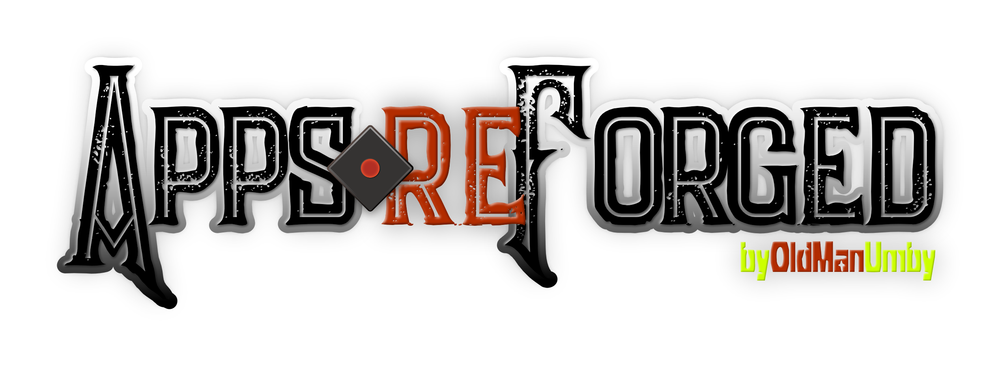

# SCHRACH (Self-Contexting Hierarchy)

SCHRACH is a framework for AI agents to maintain a system of parent and child `AGENTS.md` files at every durable boundary in a project tree. It acts as a localized, self-healing agentic memory system.

## Overview

Large language models struggle with "Lost in the Middle" syndrome when they are fed an entire codebase, or a single bloated instruction file. SCHRACH solves that by distributing project rules into a hierarchy of short, scoped Markdown files the agent is required to read before editing and to update after a meaningful change.

This work is based upon and combines two recent developments:

- [DOX](https://github.com/agent0ai/dox) by [Agent Zero](https://github.com/agent0ai): A tiny `AGENTS.md` framework that gives an AI agent precise, hierarchical project context.
- [Google OKF (Open Knowledge Format)](https://cloud.google.com/blog/products/data-analytics/how-the-open-knowledge-format-can-improve-data-sharing): An open specification that formalizes the [LLM-wiki](https://gist.github.com/karpathy/442a6bf555914893e9891c11519de94f) pattern into a portable format using Markdown and YAML frontmatter.

The result is a self-maintaining memory system. The AI understands the local rules, makes precise edits, and updates the nearest `AGENTS.md` file to keep the documentation current. Less guessing. Less drift.

## Features

- **Contextual Pruning (from DOX):** Instead of one massive instruction file, SCHRACH distributes instructions into a localized tree of `AGENTS.md` files. An agent reads the root master file in `.agents/`, then walks the directory tree to find the local guidelines for the files it intends to edit.
- **Structured Metadata (from OKF):** Every `AGENTS.md` file starts with strict YAML frontmatter (`okf_version`, `type`, `scope`, `last_updated`, `dependencies`, and `status`). Agents can parse scope and freshness without guessing at the document shape.
- **The Global Map:** A dynamically maintained `.agents/AGENTS-TREE.md` file sits alongside the master file. The agent regenerates this map whenever an `AGENTS.md` file is created, moved, or deleted, so navigation does not require a blind search.
- **Context & Decisions:** Technical code tells the AI *how*. A dedicated "Context & Decisions" section tells the AI *why*, which helps prevent agents from undoing intentional architectural choices.
- **The `.schrach/` Workspace:** A hidden directory at the project root acts as the AI's private workspace. It includes `.schrach/docs` for caching external framework documentation (so retrieval can be verbatim) and `.schrach/examples` for golden code reference patterns, plus `scripts` and `templates` folders for local tooling.
- **Retrieval Over Pre-Training:** The root rules explicitly require agents to prefer written SCHRACH files and cached docs over internal training weights.
- **Durable-Boundary Scoping:** Child `AGENTS.md` files are required only at directories that form a durable architectural boundary, which keeps small projects from drowning in documentation.
- **Safe Initialization Script:** `scripts/init-schrach.sh` scaffolds the framework in a target project *before* an agent session starts, so the model does not invent the rules from memory.

## Requirements

- A POSIX shell with `bash` to run the initialization script (macOS and Linux are supported; Windows users can run it from Git Bash or WSL).
- An AI coding agent that can read Markdown instruction files and follow them as a work contract.
- Git, if you clone the repository (recommended).

No language runtime, package manager, or API key is required to install or use the framework itself.

## Installation

1. **Clone the repository:**

   ```
   git clone https://github.com/oldmanumby/schrach.git
   cd schrach
   ```

2. **Keep this clone as your source copy.** You do not run the init script *in* the SCHRACH repo unless you are testing it. From each project that should use the framework, call the script by path as shown below.

## Usage

To prevent "premature execution" (where an agent hallucinates the framework rules instead of reading them), initialize SCHRACH with the script *before* the agent reads the rules.

### 1. Initialize a project

Open a terminal in the **target project's root directory** and run:

```bash
bash /path/to/schrach/scripts/init-schrach.sh
```

The script is safe to re-run. It will:

- Create `.agents/` if needed.
- Create `.schrach/docs`, `.schrach/examples`, `.schrach/scripts`, and `.schrach/templates`.
- Copy the master `.agents/AGENTS.md` template and stamp `last_updated` with today's date.
- If `.agents/AGENTS.md` already exists, move it to `.agents/AGENTS.backup.md` (or a timestamped backup if that file is already present) and install a fresh template. It will not merge or delete your old rules; you review the backup and copy forward anything that still applies.
- Copy `.agents/AGENTS-TREE.md` only when that file is missing. An existing map is left untouched.

### 2. Fill in the project-specific rules

Open the newly installed `.agents/AGENTS.md` and update:

- The YAML frontmatter (`scope`, `dependencies`, and any other fields that should describe this project).
- **User Preferences** for global coding rules (language, libraries, style).
- **Context & Decisions** for the architectural "why."
- **Framework Documentation Index** if you cache third-party docs under `.schrach/docs/`.
- **Custom Project Instructions** at the bottom, for this project's tech stack and any extra agent directives.

### 3. Instruct the agent

Once the files are in place, start your AI agent session. Do not bury SCHRACH initialization in a massive multi-step prompt. Give a dedicated instruction first:

> *"I have scaffolded the SCHRACH framework. Please read the root `.agents/AGENTS.md` file carefully. Then, scan my project tree and automatically generate any necessary nested `AGENTS.md` files according to the framework's rules."*

The agent is then responsible for creating child `AGENTS.md` files at durable architectural boundaries, keeping frontmatter dates and dependencies current, and regenerating `.agents/AGENTS-TREE.md` when the hierarchy changes.

### Example Workflow

1. Clone SCHRACH and run `init-schrach.sh` from the root of a new or existing project.
2. Edit `.agents/AGENTS.md` so the frontmatter, preferences, and custom instructions match the project.
3. Start the agent with the dedicated instruction above and let it build any needed child docs and the global map.
4. After meaningful code changes, expect the agent to update the nearest owning `AGENTS.md` (and parents, when structure or ownership changes) before it considers the task done.

## Directory Structure

The SCHRACH repository itself looks like this:

```text
schrach/
├── .agents/
│   ├── AGENTS.md          # Master rulebook (OKF frontmatter + framework rules)
│   └── AGENTS-TREE.md     # Starting global map of the AGENTS.md hierarchy
├── scripts/
│   └── init-schrach.sh    # Deploys the framework into a target project
├── LICENSE                # MIT License
├── CHANGELOG.md           # Release history
└── README.md              # This guide
```

After initialization, a target project gains:

```text
your-project/
├── .agents/
│   ├── AGENTS.md          # Project master rules (edit the custom sections)
│   └── AGENTS-TREE.md     # Agent-maintained global map
├── .schrach/
│   ├── docs/              # Cached external framework documentation
│   ├── examples/          # Golden code reference patterns
│   ├── scripts/           # Optional project-local helper scripts
│   └── templates/         # Optional local templates
└── ...                    # The rest of your project, plus child AGENTS.md files
                           # at durable architectural boundaries
```

## The AGENTS.md Template

Every `AGENTS.md` file starts with OKF YAML frontmatter, then follows a stable section order. The root template includes:

- **Rules** and **Core Contract** — Binding requirements for when child docs exist, how conflicts resolve (closer docs win on local detail; children may not weaken global SCHRACH rules), and the duty to prefer retrieval over pre-training.
- **Read Before Editing / Update After Editing / Closeout** — The required read path, the conditions that trigger a documentation pass, and the checklist an agent must finish before a task is done.
- **Hierarchy & Project Map** — How the root file, child files, and `AGENTS-TREE.md` relate.
- **Child Doc Shape** — Default sections for nested files: Purpose, Ownership, Local Contracts, Work Guidance, Verification, and Child Index.
- **Style** — Keep docs concise, operational, and free of stale history.
- **User Preferences**, **Context & Decisions**, **Framework Documentation Index**, and **Child Index**.
- **Custom Project Instructions** — Anything project-specific goes below this heading.

## Advanced Features

- **Non-destructive re-init:** Re-running the script never silently overwrites a live `AGENTS.md`. Existing rules are backed up, and a second backup gets a timestamp so the first one is preserved.
- **Stamped freshness:** Deployed templates receive `last_updated: YYYY-MM-DD` for the day you initialize, so new files are not born with a stale date from the upstream repo.
- **Agent-owned map:** `AGENTS-TREE.md` is labeled as agent-maintained. Do not edit it by hand; the agent regenerates it with terminal tools when the hierarchy changes. Only directories that contain an `AGENTS.md` appear on the map.
- **Cached documentation:** Point the Framework Documentation Index at files in `.schrach/docs/` so the agent can quote upstream framework material instead of relying on memory.

## Troubleshooting

- **The agent invents SCHRACH rules instead of following them:** Run `init-schrach.sh` and give the dedicated "read `.agents/AGENTS.md` first" instruction before any other implementation prompt.
- **My existing `.agents/AGENTS.md` disappeared:** It was moved, not deleted. Look for `.agents/AGENTS.backup.md` or a timestamped `.agents/AGENTS.backup.YYYYMMDDHHMMSS.md`, then copy forward the rules that still apply into **Custom Project Instructions**.
- **`AGENTS-TREE.md` did not update after init:** If that file already existed, the script leaves it alone. Ask the agent to regenerate it after it has scanned the tree.
- **Too many child `AGENTS.md` files:** Child docs are required only at durable architectural boundaries, not in every folder. Ask the agent to prune files that do not represent a distinct purpose, logic, or workflow.
- **Docs feel out of date after a change:** A SCHRACH pass is still required even when the agent decides no doc edit is needed. Confirm `last_updated` and `dependencies` were reviewed on the nearest owning file.
- **`init-schrach.sh` exits immediately:** The script runs with `set -euo pipefail`. Confirm you are invoking it with `bash` and that the `scripts` folder is still next to the `.agents` templates in your SCHRACH clone.

## License

This project is licensed under the **MIT License**.

See the [LICENSE](LICENSE) file for the complete text.
